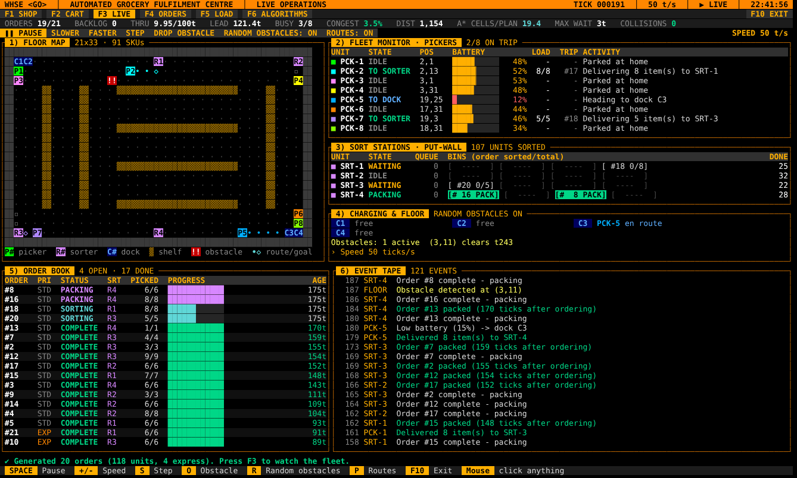
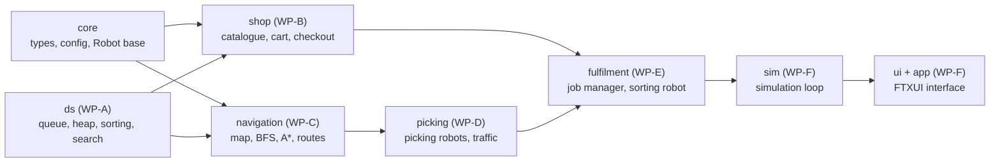

# RSE2203 Team Project: Automated Grocery Warehouse

This project simulates an automated grocery fulfilment centre. Customers place orders through a terminal-based shop, and each order is passed to a simulated warehouse in which **eight picking robots** collect items from **91 shelves** while avoiding one another and temporary obstacles. **Four sorting robots** then separate the mixed deliveries back into individual orders and pack each order with the heaviest items first. The state of the warehouse is displayed live in a terminal interface.



> **Use of generative AI.** The initial version of this code base was generated with a generative AI tool (Claude, Anthropic). The project brief [B] permits the use of generative AI for producing basic source code, provided that the output is evaluated and validated. Before submission, each work-package owner is required to complete the procedure in `docs/VALIDATION_GUIDE.md` for their module and to record the findings in `docs/GENAI_LOG.md`. In accordance with [B], at least one further generative AI tool (for example ChatGPT, GitHub Copilot or Gemini) is to be used for cross-checking; suggested comparisons are given in each module README.

---

## Problem statements

| # | Problem | Data structure / algorithm adopted | Module |
|---|---------|------------------------------------|--------|
| P1 | Customers must be able to locate a product in the catalogue efficiently. | Name index sorted with merge sort and searched with **binary search**; linear search for partial matches | `ds`, `shop` |
| P2 | Orders should be served in order of arrival, express orders should be served earlier, and no order may wait indefinitely. | **Binary min-heap** priority queue keyed on arrival time minus a fixed express bonus | `ds`, `fulfilment` |
| P3 | Robots must follow shortest paths around shelves and temporary obstacles without colliding. | **Breadth-first search** and **A\*** on the grid graph, combined with traffic rules | `navigation`, `picking` |
| P4 | A robot carrying several items should visit the corresponding shelves in a short sequence. | **Greedy** nearest-neighbour heuristic compared with exact recursive **backtracking with pruning** | `navigation` |
| P5 | Work must be distributed across eight picking robots and four sorting robots. | **Greedy** scheduling: least-loaded sorter, nearest idle robot, first-fit trip filling | `fulfilment` |
| P6 | A sorter receives items from several orders at once and must pack each order heaviest-first. | **Linked-list queue** for the conveyor and **stable merge sort** for the packing list | `ds`, `fulfilment` |

---

## Building and running

Requirements: CMake 3.16 or later and a C++17 compiler (Visual Studio 2019 or later, MinGW-w64 with GCC 9 or later, or GCC/Clang on Linux and macOS). No other downloads are needed. The user-interface library FTXUI is included in `third_party/`; the first build compiles it once, which takes approximately one minute.

```bash
# Linux / macOS
cmake -S . -B build
cmake --build build -j
ctest --test-dir build               # all module tests
./build/app/Warehouse                # interactive program

# Windows with Visual Studio (Developer Command Prompt)
cmake -S . -B build
cmake --build build --config Release
ctest --test-dir build -C Release
build\app\Release\Warehouse.exe

# Windows with MinGW (remove any existing build folder first)
cmake -S . -B build -G "MinGW Makefiles"
cmake --build build
build\app\Warehouse.exe
```

On Windows, Windows Terminal is recommended over the legacy console, with the window maximised (approximately 170 × 48 characters).

To work on a single module, the interface can be omitted to shorten build times: `cmake -S . -B build -DWH_BUILD_UI=OFF`, followed by `cmake --build build --target test_navigation` and `ctest --test-dir build -R navigation`.

**Further modes of operation**

```bash
./build/app/Warehouse --headless 80              # simulate 80 random orders and print the results
./build/app/Warehouse --headless 80 --routing greedy --assignment first
./build/app/Warehouse --snapshot 150             # print one dashboard frame (for the report)
./build/experiments/experiments all              # all experiments -> experiments/results/*.csv
python experiments/plot_results.py               # charts -> experiments/results/plots/*.png
```

**Controls.** F1–F6 select the screens (SHOP, CART, LIVE, ORDERS, LOAD, ALGORITHMS) and F10 exits; all elements can also be operated with the mouse.
- **SHOP:** `/` opens the search field; `Enter` adds the selected product to the cart.
- **LIVE:** `SPACE` pauses, `+`/`-` change the speed, `S` advances one tick, `O` places an obstacle, `R` toggles random obstacles and `P` toggles the route preview.
- **ALGORITHMS:** lists where each data structure and algorithm from the course is used, with live counters, and allows the route-planning and robot-assignment methods to be changed during a run.

---

## Work packages

| WP | Folder(s) | Owner | Data structures and algorithms | Course reference | Experiment |
|----|-----------|-------|--------------------------------|------------------|------------|
| **A** | `modules/ds` | Marissa | Linked-list queue, binary min-heap, bubble/selection/insertion/merge/quick sort, binary search | [L2], [L4], [L5a] | E1 sorting |
| **B** | `modules/shop` | Kavin | Catalogue with a binary-search name index, cart rules, exact money arithmetic (integer cents), checkout, receipts | [L1b], [L5a] | E2 searching |
| **C** | `modules/navigation` | liyou | Grid graph, breadth-first search, A\*, distance cache (memoisation), route planning (greedy and backtracking) | [L5a], [L5b], graph algorithms [S] | E3, E4 |
| **D** | `modules/picking` | Raelyn | Picking-robot state machine, battery, charging docks, traffic rules (collision and obstacle avoidance) | [L1b], [L4] | E5 fleet size |
| **E** | `modules/fulfilment` | Sam | Job manager (priority-queue backlog, greedy sorter, robot and trip selection, charging); sorting robot with put-wall bins and stable packing | [L2], [L4], [L5b] | E6 policies |
| **F** | `modules/core`, `sim`, `ui`, `app`, `experiments`, CI | _name_ (integrator) | Simulation loop, polymorphic robot collection, safety checks, FTXUI interface, experiments program | [L1b] | all |

Each module folder contains its own `README.md` (purpose, testing and validation), `CMakeLists.txt` and `tests/` directory. The Git workflow is described in `CONTRIBUTING.md`.

---

## Module dependencies



An arrow denotes "is used by". A module may include only the modules that precede it in this graph. The rule is checked by `python tools/check_dependencies.py`, which also runs in continuous integration. Further detail is given in `docs/ARCHITECTURE.md`.

---

## Validation of the code

Each owner validates their module using the procedure in `docs/VALIDATION_GUIDE.md`, which comprises the following activities:

1. **Explanation.** Every function is read and explained in the owner's own words. Code that cannot be explained is not considered validated.
2. **Test review.** The tests are run and then read, to confirm that each claim in the comments is actually tested.
3. **Hand tracing.** The worked example in the module README is traced on paper.
4. **Mutation testing.** `python tools/mutation_test.py <module>` introduces known defects and reports whether the tests detect them. Owners add mutants of their own.
5. **Cross-checking with a second generative AI tool.** The same question is put to another tool, and both responses are scored for accuracy, completeness, clarity and relevance, the evaluation criteria specified in [B], in `docs/GENAI_LOG.md`.
6. **Review for over-engineering.** Each module README lists design choices for which a simpler alternative may be preferable.

`docs/DESIGN_DECISIONS.md` records the simplifications already made relative to the previous version and the reasons for them.

---

## Experiments

The experiments support the assessment component "experiment, analysis and insight discussion" [B]. They are run with `experiments all`, followed by `plot_results.py`. The figures below are reference results from a single run (GCC on Linux). Counts are reproducible for a given seed and compiler; execution times vary between machines.

| Experiment | Principal result |
|------------|------------------|
| E1 Sorting | Bubble, selection and insertion sort grow as n²; merge and quick sort as n log n. With many duplicate keys, quick sort degrades towards n² because of the partition scheme used. |
| E2 Searching | Binary search requires at most ⌊log₂ n⌋ + 1 comparisons (20 for one million items), whereas linear search requires approximately n/2. |
| E3 BFS vs A\* | Path lengths are identical; A\* expands approximately **16%** of the cells expanded by breadth-first search. |
| E4 Routing | Greedy routes are 6–26% longer than optimal for 2–10 shelves; pruning reduces the search tree from 1.96 million to approximately 7,400 nodes at k = 7. |
| E5 Fleet size | Eight robots complete 80 orders **6.6 times** faster than one robot rather than eight times, owing to congestion. |
| E6 Policies | Backtracking routes combined with nearest-robot assignment reduce the distance travelled by **25%** relative to the baseline; most of the reduction is due to routing. |

`docs/REPORT_GUIDE.md` maps the sections of the IEEE report and the demonstration video to these results.

---

## Repository layout

```
app/                 main.cpp (Warehouse executable)
data/                Map.txt (21 x 33 grid), Products.txt (91 products, one per shelf)
docs/                architecture, validation guide, GenAI log, design decisions, report guide
experiments/         experiments.cpp, plot_results.py, results/
modules/<name>/      one folder per module: source, tests/, README.md, CMakeLists.txt
testing/             minimal unit-test framework shared by all modules
third_party/ftxui/   FTXUI 7.0.3 (MIT licence), amalgamated into one .hpp and one .cpp file
tools/               check_dependencies.py, mutation_test.py
.github/             CI workflow, CODEOWNERS, pull-request and issue templates
```

**Submission.** The brief [B] requires a compressed file named `RSE2203_TeamXY.zip` containing all source files and libraries. This folder is to be compressed without the `build/` directory.

**Third-party software.** FTXUI, © Arthur Sonzogni, MIT licence (`third_party/ftxui/LICENSE`). All other code was written for this project.

---

## References

Citation keys used throughout this repository:

| Key | Source |
|-----|--------|
| [B] | Singapore Institute of Technology, *RSE2203 Data Structures and Algorithms: Team Project (2026)*, project brief. |
| [L1a] | RSE2203 Lecture 1a, *Introduction*. |
| [L1b] | RSE2203 Lecture 1b, *OO Concepts & C++ Review*. |
| [L2] | RSE2203 Lecture 2, *Basic Data Structures*. |
| [L3] | RSE2203 Lecture 3, *Analysis of Algorithms*. |
| [L4] | RSE2203 Lecture 4, *Sorting Algorithms*. |
| [L5a] | RSE2203 Lecture 5a, *Algorithm Design: Recursion*. |
| [L5b] | RSE2203 Lecture 5b, *Algorithm Design: Divide and Conquer, Greedy, & Backtracking*. |
| [S] | RSE2203 course schedule (in [L1a]): *Searching Algorithms* (weeks 8–9) and *Graph Algorithms* (weeks 10–11). |
