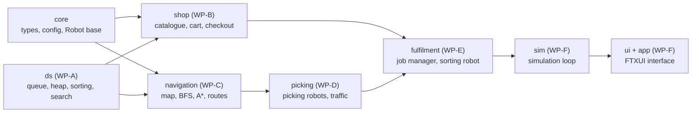

# RSE2203 Team Project: Automated Grocery Warehouse

Customers shop in a terminal web-shop. Each order is sent to a simulated warehouse. There, **8 picking robots** fetch the items from **91 shelves**, avoiding each other and random obstacles. **4 sorting robots** split the mixed deliveries back into orders and pack them heaviest-first. Everything is shown live in a "Bloomberg-terminal" style interface.


> **GenAI notice.** The first version of this code was generated with GenAI (Claude, by Anthropic). The project brief allows GenAI, but **every output must be validated**. Before submission, each work package owner must work through `docs/VALIDATION_GUIDE.md` for their module and record their findings in `docs/GENAI_LOG.md`. The brief asks for at least two GenAI tools. The module READMEs suggest cross-checks with a second tool (ChatGPT, Copilot, Gemini …).

---

## Problem statements

| # | Problem | Our data structure / algorithm | Module |
|---|---------|--------------------------------|--------|
| P1 | Customers must find a product quickly in the catalogue. | Merge-sorted name index + **binary search**; linear search for partial matches | `ds`, `shop` |
| P2 | Orders must be served first-come-first-served, but express orders earlier, and nobody may wait for ever. | **Binary min-heap** priority queue with an "arrival time − express bonus" key | `ds`, `fulfilment` |
| P3 | Robots must drive shortest paths around shelves and sudden obstacles without crashing into each other. | **BFS** and **A\*** on the grid graph, plus simple traffic rules | `navigation`, `picking` |
| P4 | A robot that carries several items should visit the shelves in a short order. | **Greedy** nearest-neighbour vs. recursive **backtracking with pruning** (exact) | `navigation` |
| P5 | Work must be spread over 8 robots and 4 sorters. | **Greedy** scheduling: least-loaded sorter, nearest idle robot, first-fit trip filling | `fulfilment` |
| P6 | A sorter receives items of many orders mixed together and must pack each order heaviest-first. | **Linked-list queue** (conveyor) + **stable merge sort** | `ds`, `fulfilment` |

---

## Quick start

You need CMake ≥ 3.16 and a C++17 compiler: Visual Studio 2019+, MinGW-w64 (GCC 9+), or GCC/Clang on Linux/macOS. Nothing else needs downloading. The UI library FTXUI is included in `third_party/`, and the first build compiles it once, which takes about 1 minute.

```bash
# Linux / macOS
cmake -S . -B build
cmake --build build -j
ctest --test-dir build               # all module tests
./build/app/Warehouse                # the interactive program

# Windows + Visual Studio (Developer Command Prompt)
cmake -S . -B build
cmake --build build --config Release
ctest --test-dir build -C Release
build\app\Release\Warehouse.exe

# Windows + MinGW (delete an old build folder first)
cmake -S . -B build -G "MinGW Makefiles"
cmake --build build
build\app\Warehouse.exe
```

Use **Windows Terminal** (not the old console) and maximise the window (about 170 × 48 characters).

**Working on one module only?** Skip the UI to build much faster:
`cmake -S . -B build -DWH_BUILD_UI=OFF`, then `cmake --build build --target test_navigation`, then `ctest --test-dir build -R navigation`.

**Other ways to run it**

```bash
./build/app/Warehouse --headless 80              # simulate 80 random orders, print the results
./build/app/Warehouse --headless 80 --routing greedy --assignment first
./build/app/Warehouse --snapshot 150             # print one dashboard picture (for the report)
./build/experiments/experiments all              # every experiment -> experiments/results/*.csv
python experiments/plot_results.py               # charts -> experiments/results/plots/*.png
```

**Using the program:** F1–F6 switch screens (SHOP, CART, LIVE, ORDERS, LOAD, ALGORITHMS) and F10 exits. You can click everything with the mouse.
- **SHOP:** `/` searches, `Enter` adds to the cart.
- **LIVE:** `SPACE` pauses, `+`/`-` change the speed, `S` steps one tick, `O` drops an obstacle, `R` toggles random obstacles, `P` toggles route preview.
- **ALGORITHMS:** shows where every course topic runs, with live counters, and lets you switch the route-planning and robot-choice algorithms while the warehouse runs.

---

## Work packages (one per team member)

| WP | Folder(s) | Owner | Data structures & algorithms | Lectures | Experiment |
|----|-----------|-------|------------------------------|----------|------------|
| **A** | `modules/ds` | _name_ | Linked-list queue, binary min-heap, bubble / selection / insertion / merge / quick sort, binary search | L2, L4, L5a | E1 sorting |
| **B** | `modules/shop` | _name_ | Catalogue with binary-search name index, cart rules, exact money (integer cents), checkout, receipts | L1b, L5a | E2 search |
| **C** | `modules/navigation` | _name_ | Grid graph, BFS, A\*, distance cache (memoisation), route planning: greedy vs backtracking | L5a, L5b, wk 10–11 | E3 BFS vs A\*, E4 routing |
| **D** | `modules/picking` | _name_ | Picking-robot state machine, battery, docks, traffic rules (collision and obstacle avoidance) | L1b, L4 | E5 fleet size |
| **E** | `modules/fulfilment` | _name_ | Job manager: priority-queue backlog, greedy sorter/robot/trip choices, charging; sorting robot with put-wall bins and stable packing | L2, L4, L5b | E6 policies |
| **F** | `modules/core`, `sim`, `ui`, `app`, `experiments`, CI | _name_ (integrator) | Simulation loop, polymorphic robot list, safety checks, FTXUI interface, experiments program | L1b | runs all |

Every module folder has its own `README.md` (what it does, how to test it, how to validate it), its own `CMakeLists.txt` and its own `tests/`. See `CONTRIBUTING.md` for the Git workflow.

---

## How the modules fit together



An arrow means "is used by". A module may only `#include` modules to its left. `python tools/check_dependencies.py` checks this rule, and CI runs it. The details are in `docs/ARCHITECTURE.md`.

---

## Validating the code (read this before changing anything)

Each owner validates their module with the steps in `docs/VALIDATION_GUIDE.md`:

1. **Read and explain** every function. If you cannot explain it, it is not validated.
2. **Run the tests**, then read them. Is each claim in the comments actually tested?
3. **Hand-trace** the small example in your module README on paper.
4. **Break it on purpose.** `python tools/mutation_test.py <module>` plants known bugs and checks that the tests catch them. Then add your own.
5. **Cross-check with a second GenAI tool.** Ask it the same question and score both answers on Accuracy, Completeness, Clarity and Relevance (the brief's criteria) in `docs/GENAI_LOG.md`.
6. **Look for over-engineering.** Each module README lists questions where a simpler choice might be better.

`docs/DESIGN_DECISIONS.md` records what was already simplified compared with the previous version, and why.

---

## Experiments (for the 20% "experiment, analysis and insight" mark)

Run `experiments all` and then `plot_results.py`. These are reference results from one run (GCC on Linux). Counts repeat exactly for the same seed and compiler; times differ by computer.

| Experiment | Headline result |
|------------|-----------------|
| E1 Sorting | Bubble, selection and insertion sort grow as n²; merge and quick sort as n log n. Quick sort with many duplicate values degrades to about n² (a weakness of this partition scheme). |
| E2 Search | Binary search needs at most ⌊log₂ n⌋ + 1 comparisons, for example 20 for one million items; linear search needs about n/2. |
| E3 BFS vs A\* | Same path lengths; A\* expands about **16%** of the cells BFS expands. |
| E4 Routing | Greedy routes are 6–26% longer than optimal for 2–10 shelves; pruning cuts the search tree from 1.96 million to about 7,400 nodes at k = 7. |
| E5 Fleet size | 8 robots finish 80 orders **6.6×** faster than 1 robot, not 8×, because of congestion. |
| E6 Policies | Backtracking routes + nearest robot drive **25% less** than the baseline; most of the gain comes from routing. |

`docs/REPORT_GUIDE.md` maps the IEEE report sections and the demo video to these files.

---

## Repository layout

```
app/                 main.cpp (Warehouse executable)
data/                Map.txt (21 x 33 grid), Products.txt (91 products, one per shelf)
docs/                architecture, validation guide, GenAI log, design decisions, report guide
experiments/         experiments.cpp, plot_results.py, results/
modules/<name>/      one folder per module: code, tests/, README.md, CMakeLists.txt
testing/             the tiny unit-test framework used by all modules
third_party/ftxui/   FTXUI 7.0.3 (MIT licence), amalgamated into one .hpp + one .cpp
tools/               check_dependencies.py, mutation_test.py
.github/             CI workflow, CODEOWNERS, pull-request and issue templates
```

**Submission:** the brief asks for `RSE2203_TeamXY.zip` with all sources and libraries. Zip this folder without `build/`.

**Third-party code:** FTXUI © Arthur Sonzogni, MIT licence (`third_party/ftxui/LICENSE`). Everything else was written for this project.
