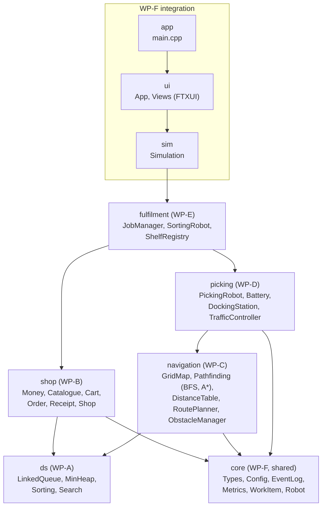
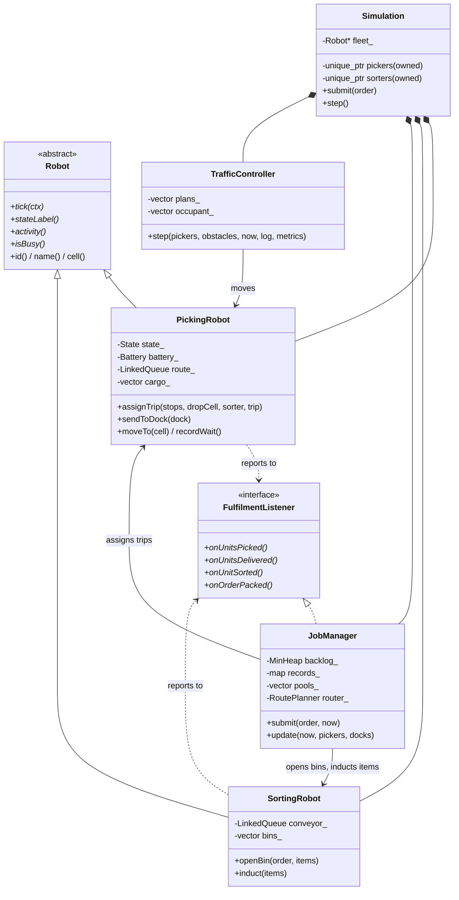
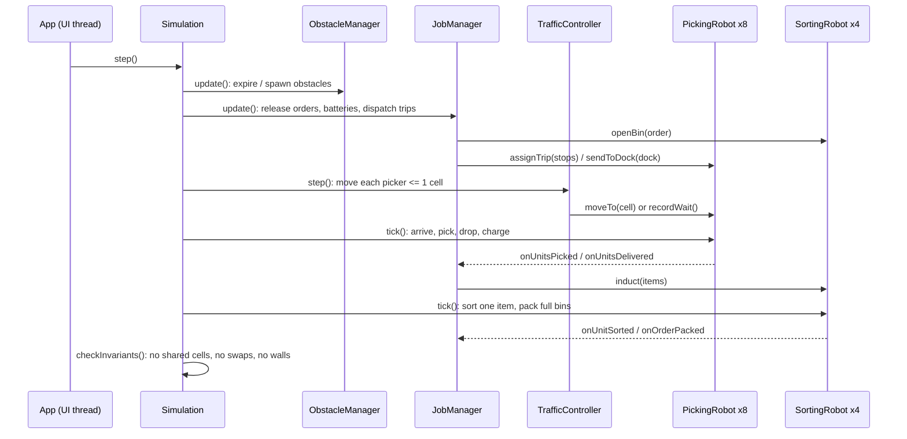
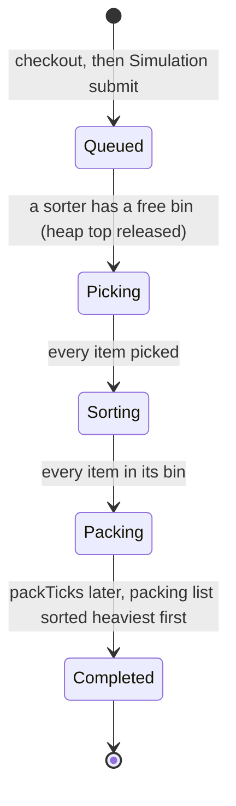
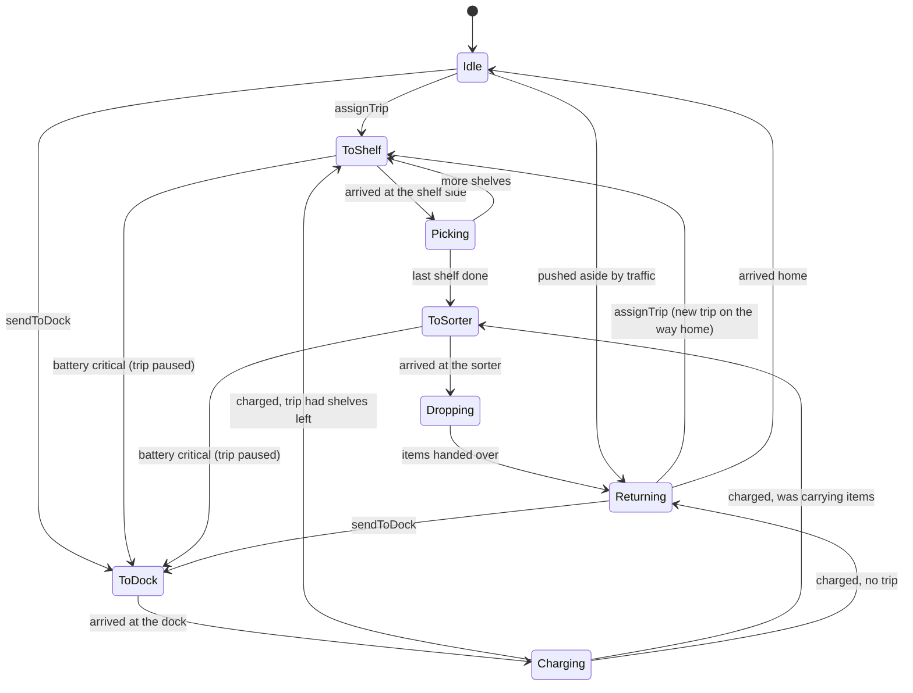

# Architecture

GitHub renders the diagrams in this document automatically. A diagram is edited by changing the text of its `mermaid` block; changes can be previewed at https://mermaid.live. Citation keys refer to the *References* section of the root `README.md`.

## 1. Modules and the dependency rule

An arrow denotes "uses". The dependency graph is acyclic, so each module can be built and tested using only the modules beneath it. The `ds` module has no dependencies at all, which allows WP-A to test its containers on plain `int` values without any warehouse code.

Circular dependencies are avoided as follows:

- **Robots and the job manager:** robots report progress through the abstract class `FulfilmentListener` in `core/Robot.hpp`, which `JobManager` implements. No robot class includes `JobManager.hpp`.
- **Picking robots and sorting robots:** a picking robot knows only the drop-off *cell* and the *index* of its sorter. On delivery it calls `listener.onUnitsDelivered(sorterIndex, items)`, and the job manager passes the items to the corresponding sorter.

## 2. Main classes

**Ownership.** `Simulation` owns every robot through `std::unique_ptr`, so robots are released automatically and never move in memory. All other classes hold non-owning raw pointers (`PickingRobot*`), meaning that they use the object without owning it. `fleet_` stores every robot as a `Robot*`, so that a single loop can call `robot->tick()` on both robot types through dynamic dispatch, an application of polymorphism as introduced in Lecture 1b [L1b].

## 3. Sequence of one simulation tick

## 4. Order life cycle

## 5. Picking-robot state machine

## 6. Threads (interface only)

The model (`sim` and all modules beneath it) is single-threaded; it neither sleeps nor produces output. The interface runs FTXUI on the main thread. A clock thread wakes every 50 ms and posts a task to the interface thread with `App::Post`; that task calls `Simulation::step()` as many times as the selected speed requires. Because only one thread ever accesses the model, no locks are required.

## 7. Data files

- `data/Map.txt`: one character per cell (`W` wall, `.` floor, `S` shelf, `C` charging dock, `R` sorting robot, `T` picking-robot home); spaces are ignored. `GridMap::parse` reports the line number of any error and uses breadth-first search to verify that every shelf, sorter, dock and home is reachable.
- `data/Products.txt`: `Name Price WeightKg Stock ShelfRow ShelfCol [Category]`. `ShelfRegistry` verifies that every product is located on an `S` cell and that the number of products equals the number of shelves (91).
