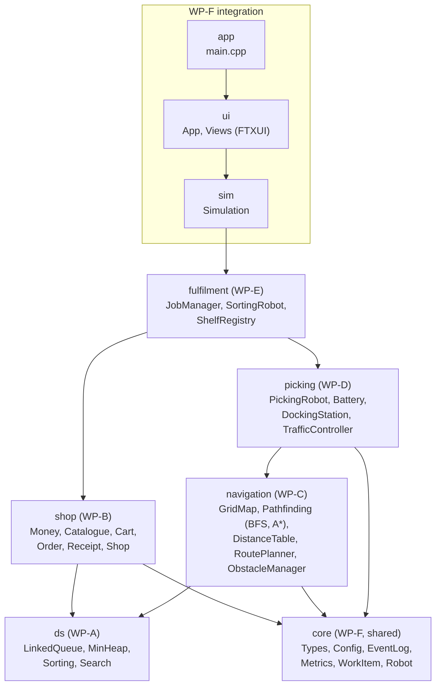
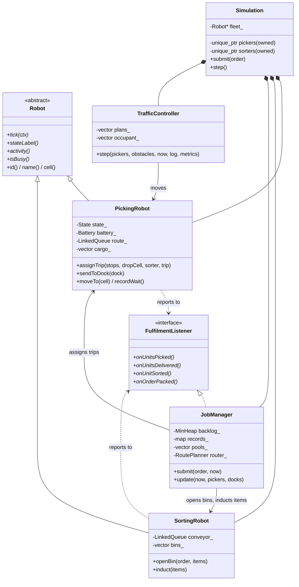
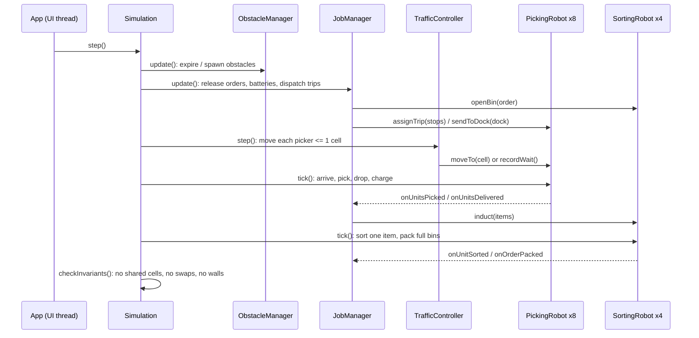
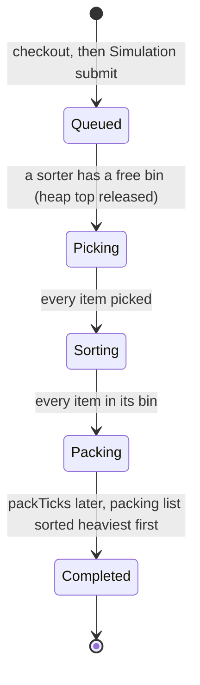
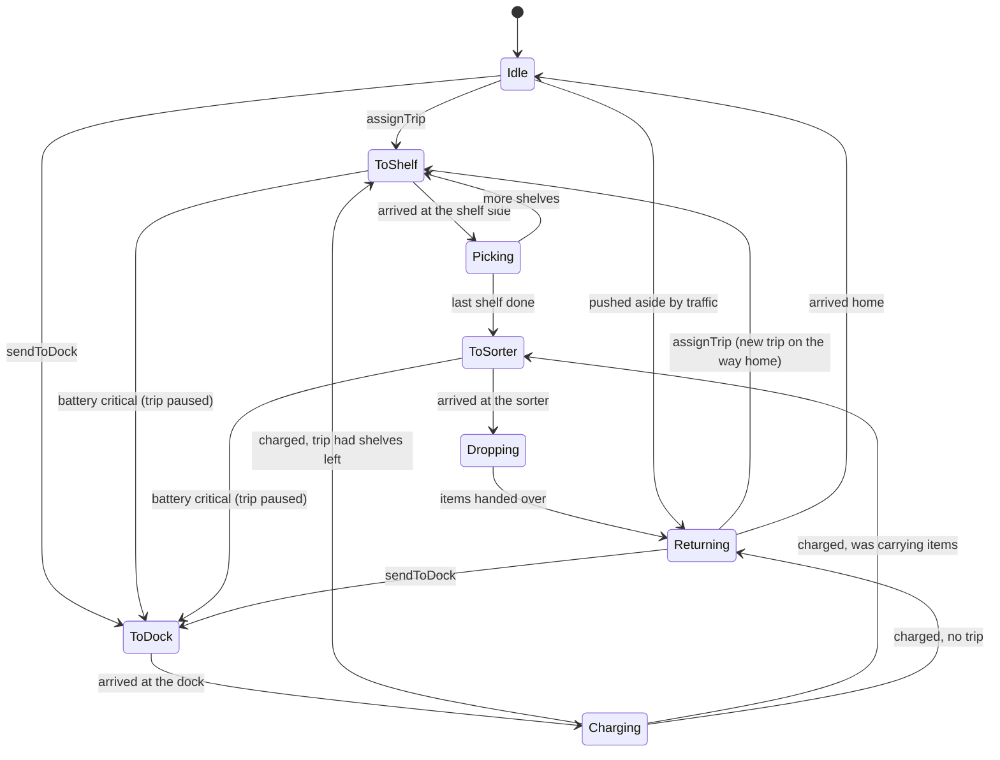

# Architecture

GitHub draws the diagrams below automatically. To edit one, change the text in the `mermaid` block; https://mermaid.live previews it.

## 1. Modules and the dependency rule

An arrow means "uses". The arrows never form a loop, so each module can be built and tested with only the modules below it. `ds` uses nothing at all. This is why WP-A can test its queue on plain `int`s without a warehouse.

How the loops are avoided:

- **Robots → JobManager:** robots report progress through the abstract class `FulfilmentListener` in `core/Robot.hpp`, and `JobManager` implements it. A robot never includes `JobManager.hpp`.
- **PickingRobot → SortingRobot:** a picker only knows the drop-off *cell* and the sorter's *number*. On delivery it calls `listener.onUnitsDelivered(sorterIndex, items)`, and the JobManager passes the items to the right sorter.

## 2. Main classes

**Ownership:** `Simulation` owns every robot through `std::unique_ptr`, so robots are deleted automatically and never move in memory. Everyone else holds plain pointers (`PickingRobot*`), which means "I use it but do not own it". `fleet_` holds all robots as `Robot*`, so one loop can call `robot->tick()` on both kinds (polymorphism, Lecture 1b).

## 3. One tick

## 4. Life of an order

## 5. Picking robot states

## 6. Threads (UI only)

The model (`sim` and everything below it) is single-threaded. It never sleeps and never prints. The UI runs FTXUI on the main thread. A small clock thread wakes every 50 ms and posts a job to the UI thread with `App::Post`. That job calls `Simulation::step()` as many times as the chosen speed needs. Only one thread ever touches the model, so no locks are needed.

## 7. Data files

- `data/Map.txt`: one character per cell: `W` wall, `.` floor, `S` shelf, `C` charging dock, `R` sorting robot, `T` picker home. Spaces are ignored. `GridMap::parse` reports the line number of any error and checks with BFS that every shelf, sorter, dock and home can be reached.
- `data/Products.txt`: `Name Price WeightKg Stock ShelfRow ShelfCol [Category]`. `ShelfRegistry` checks that every product sits on an `S` cell and that there are exactly as many products as shelves (91).
